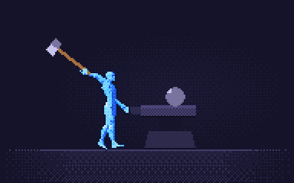
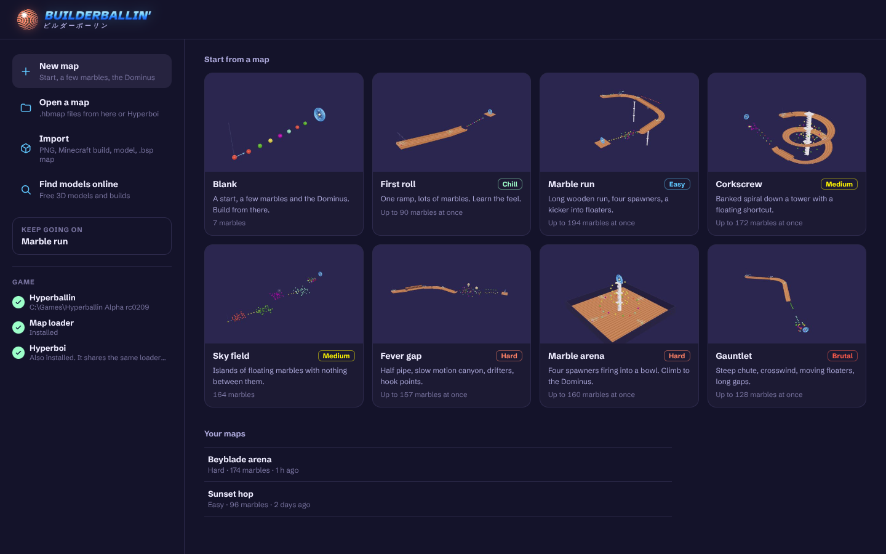
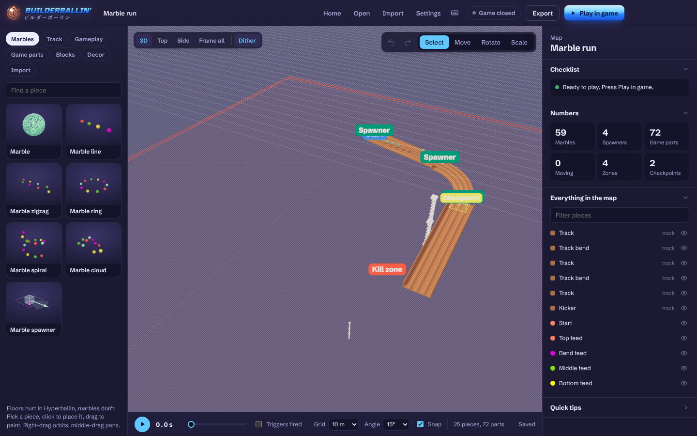
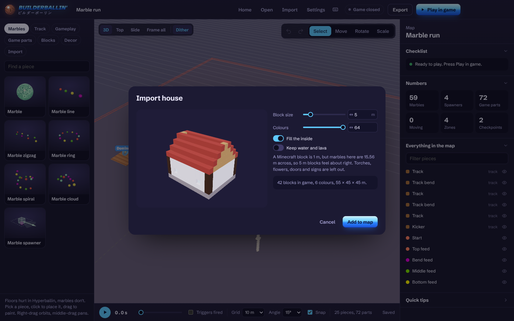

<p align="center">
  
</p>

# Builderballin

A map editor for [Hyperballin](https://itch.io/search?q=hyperballin). Build a course full of marbles, press **Play in game**, and you're playing it in the real game a few seconds later.

You don't need [Hyperboi](https://github.com/drapids/Hyperboi) for any of this. If you do have it, both apps use the same map loader and the same map list, so maps you make here show up there too.

**[Try it in the browser](https://drapids.github.io/Hyperboi/builderballin/)** (no game launching from the browser, export the map and drop it into Hyperboi instead).

<p align="center">
  
</p>

## Getting it

1. Install [Node.js](https://nodejs.org/en/download) (the LTS one).
2. Download this repo and double-click **Start Builderballin.bat**. The first run installs what it needs, which takes a minute.

If you'd rather have a single exe, run **Build Builderballin exe.bat** and grab `Builderballin.exe` from the `dist` folder.

## Playing your map in the game

The first time, Builderballin sets the game up for you:

1. **Find Hyperballin.** It looks in Downloads, Desktop, Documents and itch on its own. If it can't find it, point it at the folder.
2. **Install the map loader.** One click. It downloads UE4SS and puts it in the game folder along with the map loader. Same loader Hyperboi uses.
3. **Play in game.** If the game is closed it opens it, and your map loads right after the main menu. You get a loading screen while it builds, so big maps don't drop you into the normal level wondering if anything is happening.

Touch the Dominus and you go to the next map in your list, then into the game's next level after the last one.

The pill next to the Play button shows what the game is doing: closed, in the menu, loading your map with a percentage, playing, or your finish time.

## What's in it



- **Marbles first.** In Hyperballin the floor hurts you and marbles don't, so everything is built around them. Single marbles, lines, zigzags, rings, spirals, clouds, and spawners that throw rolling marbles down a track like every stage in the game does. They're the real game marbles, same size and colours.
- **Wooden track** that bends, banks, drops, kicks and half pipes, plus the game's own parts (the stage track, half tunnels, wall blocks, pillars, hook points and more) at their real size.
- **Gameplay pieces:** the Dominus, checkpoints, kill zones, bounce and boost pads, speed, gravity, wind, slow motion, teleporters, triggers and messages.
- **Motion** on anything: move along a path, spin, swing or blink, right away or when a trigger fires.
- **Eight starter maps:** Blank, First roll, Marble run, Corkscrew, Sky field, Fever gap, Marble arena and Gauntlet. They're packed with marbles, with gaps in between, because that's the whole game.
- **A start screen** with the starter maps, your recent maps and the game setup in one place.

## Importing



Hit **Import**, drop a file on the map, or open the Import tab.

| What | Files | How it comes in |
| --- | --- | --- |
| Pictures | `.png` `.jpg` `.webp` | A standing picture, a flat floor, or terrain where brighter pixels go higher |
| Minecraft builds | `.schem` `.schematic` `.litematic` `.nbt` | Block for block, with real block colours. Slabs, carpets, fences and panes keep their shape, torches and flowers are left out |
| Voxel art | `.vox` (MagicaVoxel) | Voxel for voxel |
| 3D models | `.glb` `.gltf` `.obj` + `.mtl` `.stl` `.ply` `.fbx` `.3mf`, or a `.zip` of them | The real shape with real collision, or turned into blocks if you want |
| Whole maps | `.bsp` (CS:GO, CS:S, HL2, TF2, Gmod) and big `.glb` levels | The real level geometry, coloured from its textures. Dust 2 works |

For models and maps there's a **Quality** slider. 100% keeps every triangle. Lower merges them so huge maps load faster and don't lag. You can also pick **Blocks** instead if you want the voxel look or a lighter map.

Maps from Counter-Strike and friends are tiny next to a marble, so there's a scale setting. **Marble size** makes the halls wide enough to roll through.

## Finding models

**Find models online** searches Sketchfab and Poly Haven right inside the app, like searching for images in a flashcard app.

- Only free models show up. Paid ones are never listed.
- **Free**, **Sign up required** and **Could lag** tags on every result, and you can hide the last two.
- Poly Haven models import in one click. Sketchfab makes you sign in to download, so it opens the page in a window inside Builderballin. Press Download there and it comes straight into the importer. Paste your Sketchfab API token once and it's one click there too.
- **Minecraft builds** opens Planet Minecraft or Minecraft Schematics inside the app. Anything you download there goes straight into the importer.

## Files

Maps save as `.hbmap` files in `Documents\Builderballin` (Ctrl+S). Hyperboi opens the same files. Ctrl+O opens one, Ctrl+N goes back to the start screen.

## Running from source

```
npm install
npm start
```

`hook/` is the in-game side: a UE4SS Lua mod that reads the map files, spawns everything, runs the marbles, zones and timer, and shows the loading screen. The editor is plain HTML and JavaScript in `app/` using three.js.

## License

MIT
